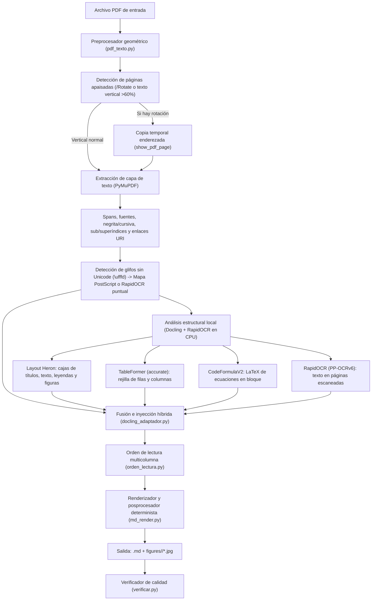

# Arquitectura del motor híbrido

`pdf2md-local` está diseñado en torno a una premisa fundamental:

> **En un PDF digital, los caracteres y coordenadas de la capa de texto (`PyMuPDF`) son exactos, mientras que los modelos de visión (`Docling`) son excelentes entendiendo la estructura espacial (columnas, tablas, figuras y fórmulas).**

En lugar de dejar que un modelo de visión o LLM reescriba el texto corrido del documento (lo que suele introducir errores de transcripción, pérdida de subíndices o alteración de cifras), `pdf2md-local` **cruza las cajas estructurales de Docling con los *spans* nativos de PyMuPDF**.

---

## 1. Diagrama del flujo de procesamiento

---

## 2. Módulos del paquete `pdf2md`

| Módulo | Responsabilidad principal |
|---|---|
| `pdf2md/md_modelo.py` | Estructuras de datos inmutables del documento intermedio (`Documento`, `Pagina`, `Bloque`, `Linea`, `Tramo`, `Tabla`, `CeldaTabla`, `Figura`, `Formula`). |
| `pdf2md/pdf_texto.py` | Extracción de bajo nivel con `PyMuPDF` (`fitz`): lectura de caracteres, detección de subíndices/superíndices por tamaño y línea base, extracción de hipervínculos, detección de páginas escaneadas, enderezado de páginas rotadas y rescate de glifos sin mapa Unicode. |
| `pdf2md/orden_lectura.py` | Reconstrucción geométrica del orden de lectura en páginas de 1, 2 o más columnas, intercalando bloques de ancho completo (títulos, tablas o figuras que cruzan columnas) en el punto vertical exacto. |
| `pdf2md/docling_adaptador.py` | Orquestación de `Docling` y `RapidOCR`, cruce de cajas de diseño con los caracteres de `PyMuPDF`, reconstrucción de celdas de tablas, recorte limpio de figuras y filtrado de cabeceras/pies repetidos. |
| `pdf2md/md_render.py` | Serialización del árbol `Documento` a Markdown y HTML, limpieza de artefactos editoriales, unión de palabras cortadas por guion y compactación de listas bibliográficas. |
| `pdf2md/cli.py` | Interfaz de línea de comandos (`pdf2md`), particionado de lotes (`--parte`, `--lista`), gestión de memoria (`gc.collect`) y registro en `_conversion.log`. |
| `pdf2md/verificar.py` | Auditoría independiente (`pdf2md-verificar`) que compara el vocabulario y conteo de palabras de cada página del PDF frente al Markdown generado. |
| `pdf2md/modelos.py` | Descargador unificado (`pdf2md-modelos`) de los pesos de `Docling` y `RapidOCR` con resolución DNS-over-HTTPS (DoH) de respaldo. |

---

## 3. Catálogo de correcciones deterministas

El flujo incorpora más de 25 reglas deterministas desarrolladas y validadas mediante pruebas unitarias para resolver fallos habituales en artículos científicos de distintas editoriales (Elsevier, Springer, Wiley, MDPI, RSC, Frontiers, IEEE, tesis y libros técnicos):

### Extracción de texto y glifos (`pdf_texto.py`)
1. **Enderezado de páginas apaisadas:** Detecta páginas con `/Rotate` (`90`, `180`, `270`) o páginas verticales donde más del `60 %` de los caracteres están rotados verticalmente (típico de tablas a página completa giradas 90°) y genera una copia temporal enderezada antes de pasar por `Docling` y `PyMuPDF`.
2. **Rescate de glifos sin mapa `ToUnicode` (`U+FFFD`):**
   - Primero consulta una tabla determinista de nombres de glifo PostScript/Adobe (`/Differences`) para fuentes matemáticas y técnicas frecuentes (`alpha`, `beta`, `Delta`, ` minus`, `pm`, `degree`, `prime`, etc.).
   - Si el glifo proviene de una fuente sin nombre estándar pero tiene tinta en la página, recorta el renglón a alta resolución y utiliza `RapidOCR` (o comparación de mapas de bits de glifos en cabeceras/títulos) para recuperar el carácter exacto.
   - Si el carácter `U+FFFD` no tiene avance horizontal o está en blanco (usado como tabulador por algunas fuentes de maquetación), lo convierte en espacio limpio.
3. **Subíndices y superíndices precisos:** Evalúa simultáneamente los bits de bandera de la fuente, la proporción de tamaño respecto al cuerpo de la línea y el desplazamiento vertical de la línea base (`baseline`), evitando falsos positivos en notas al pie o títulos pequeños.
4. **Limpieza de etiquetas invisibles de maquetación:** Filtra marcas estructurales invisibles incrustadas en la capa de texto de algunos PDFs (como `TagedP`, `TagedH1`, `TagedEnd`, `TagedEn`) que no tienen representación visual en la página.
5. **Compactación de texto con letras espaciadas:** Detecta y recompone secuencias de apellidos o títulos maquetados con espacios simples entre cada letra (`K i c z o r o w s k a` → `Kiczorowska`).

### Tablas e índices (`docling_adaptador.py`)
6. **Cruce híbrido de celdas de tabla:** En lugar de usar el texto interno de `TableFormer` (que puede truncar el último carácter de números de acceso o códigos largos), rellena cada celda con los caracteres reales de `PyMuPDF` que caen dentro de su caja geométrica, preservando subíndices, superíndices y enlaces.
7. **Rescate de celdas multilínea y palabras omitidas:** Cuando `TableFormer` encoge una caja de celda y deja fuera líneas o palabras presentes en el área de la tabla del PDF, el adaptador realinea las filas y columnas mediante proyección geométrica de las líneas reales del PDF.
8. **Separación de cabeceras fusionadas con la primera fila de datos:** Si `TableFormer` agrupa el encabezado de una columna y el primer valor numérico en una misma celda `<th>`, los separa automáticamente en fila de cabecera y primera fila de `<tbody>`.
9. **Detección de tablas de índice con puntos guía:** En tesis y libros, los índices de contenido (`1. Introducción ....... 12`) suelen ser confundidos con tablas por los modelos visuales, cortando palabras a mitad de sílaba. El adaptador detecta los puntos guía y los convierte en párrafos limpios.

### Figuras, fórmulas y limpieza editorial (`docling_adaptador.py` + `md_render.py`)
10. **Recorte de figuras sin texto de leyenda:** Ajusta la caja de recorte de cada figura para excluir el párrafo de `Figure N.` o `Fig. N.`, evitando que el texto del pie quede incrustado en el `.jpg` y repetido debajo en Markdown.
11. **Filtrado de logos editoriales y marcas de agua:** Descarta imágenes repetidas en la misma posición entre páginas, iconos diminutos en cabeceras/pies y fondos repetidos.
12. **Filtrado de cabeceras y pies de página repetidos (*running headers/footers*):** Analiza las franjas superior e inferior de todas las páginas del documento para suprimir cabeceras de revista, DOIs repetidos y numeración de páginas sin afectar al contenido real.
13. **Eliminación de numeración de líneas de manuscritos en revisión:** Detecta y descarta columnas de números de línea consecutivos (`1, 2, 3...` o `5, 10, 15...`) en los márgenes de borradores académicos (*peer-review proofs*).

